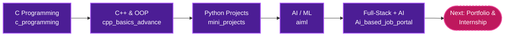

<!-- ╔════════════════════════════════════════════════════╗
     ║   ANJALI TIWARI  ·  GITHUB PROFILE README (PRO)    ║
     ╚════════════════════════════════════════════════════╝ -->

<!-- ═══════════════ HERO ═══════════════ -->
<div align="center">


<a href="https://github.com/anjalitiwarics27-coder">
  
</a>

<br/>


<br/><br/>

<a href="#about"></a>
<a href="#skills"></a>
<a href="#journey"></a>
<a href="#projects"></a>
<a href="#stats"></a>
<a href="#contact"></a>

</div>


<!-- ═══════════════ ABOUT ═══════════════ -->
<a name="about"></a>
## 👩‍💻 &nbsp;About Me

<table>
<tr>
<td width="52%" valign="top">

```yaml
👤 Name        : Anjali Tiwari
🎓 Education   : B.Tech CSE @ IILM
🤖 Focus       : AI / ML  +  Full-Stack Dev
🧠 Practice    : DSA — LeetCode & GeeksforGeeks
💻 Languages   : C · C++ · Python · HTML
🎯 Aiming for  : Internship & real-world projects
```

</td>
<td width="48%" valign="top">

🔭 **Working on** &nbsp;→&nbsp; AI/ML projects & web apps  
🌱 **Learning** &nbsp;→&nbsp; Machine Learning & DSA  
🤝 **Collaborate on** &nbsp;→&nbsp; AI & web projects  
💬 **Ask me about** &nbsp;→&nbsp; C, C++ & Python basics  
⚡ **Motto** &nbsp;→&nbsp; *Code. Eat. Sleep. Repeat.*

</td>
</tr>
</table>

<details>
<summary><b>✨ A few more things about me (click to open)</b></summary>
<br/>

- 🎧 I code best with music on
- 📚 I document my learning journey in public repos
- 🧩 I enjoy breaking big problems into small, solvable pieces
- 🚀 Always up for a new project or hackathon idea

</details>


<!-- ═══════════════ SKILLS ═══════════════ -->
<a name="skills"></a>
## 🛠️ &nbsp;Tech Stack

<div align="center">

<table>
<tr>
<td align="center" width="180"><b>⚙️ Languages</b></td>
<td align="left"></td>
</tr>
<tr>
<td align="center"><b>🎨 Web Development</b></td>
<td align="left"></td>
</tr>
<tr>
<td align="center"><b>🤖 AI / ML</b></td>
<td align="left">
  
  
</td>
</tr>
<tr>
<td align="center"><b>🧰 Tools</b></td>
<td align="left"></td>
</tr>
</table>

</div>


<!-- ═══════════════ JOURNEY ═══════════════ -->
<a name="journey"></a>
## 🗺️ &nbsp;My Learning Journey




<!-- ═══════════════ PROJECTS ═══════════════ -->
<a name="projects"></a>
## 🚀 &nbsp;Featured Projects

<div align="center">

<a href="https://github.com/anjalitiwarics27-coder/Ai_based_job_portal">
  
</a>
<a href="https://github.com/anjalitiwarics27-coder/ai-hospital-appointment-system-frontend">
  
</a>
<a href="https://github.com/anjalitiwarics27-coder/aiml">
  
</a>
<a href="https://github.com/anjalitiwarics27-coder/mini_projects">
  
</a>
<a href="https://github.com/anjalitiwarics27-coder/cpp_basics_advance">
  
</a>
<a href="https://github.com/anjalitiwarics27-coder/c_programming">
  
</a>

<br/>

<a href="https://github.com/anjalitiwarics27-coder?tab=repositories">
  
</a>

</div>


<!-- ═══════════════ STATS ═══════════════ -->
<a name="stats"></a>
## 📊 &nbsp;GitHub Analytics

<div align="center">


&nbsp;


<br/><br/>


<br/><br/>


<br/><br/>


</div>


<!-- ═══════════════ CODING PROFILES ═══════════════ -->
## 🧩 &nbsp;Coding Profiles

<div align="center">

<a href="https://leetcode.com/u/anjalitiwari23/"></a>
<a href="https://www.geeksforgeeks.org/profile/anjalitiwwz3l"></a>

<br/><br/>


</div>


<!-- ═══════════════ GOALS ═══════════════ -->
## 🎯 &nbsp;Goals & Roadmap

| Status | Goal |
|:---:|---|
| ✅ | Create a professional GitHub profile |
| 🔄 | Build strong AI/ML projects |
| 🔄 | Solve 200+ DSA problems |
| ⏳ | Build & deploy my portfolio website |
| ⏳ | Land an internship |
| ⏳ | Make my first open-source contribution |


<!-- ═══════════════ CONTACT ═══════════════ -->
<a name="contact"></a>
## 🌐 &nbsp;Let's Connect

<div align="center">

**Have a project idea, an internship opportunity, or just want to say hi? I'd love to hear from you!**

<br/>

<a href="https://www.linkedin.com/in/anjali-tiwari-988374285"></a>
<a href="mailto:anjali.tiwari.cs27@iilm.edu"></a>
<a href="https://leetcode.com/u/anjalitiwari23/"></a>

<br/><br/>


<br/>

<sub>Made with 💜 and a lot of chai by <b>Anjali Tiwari</b> &nbsp;·&nbsp; ⭐ Thanks for stopping by!</sub>


</div>
