<!--
FINAL README (rename this file to README.md in your profile repo).
Required files in the repo:
  assets/banner.svg, assets/divider.svg, assets/skills.svg, assets/footer.svg
  assets/hero-character.svg, assets/experience-timeline.svg   (already there)
  .github/workflows/snake.yml, .github/workflows/update-readme.yml
  scripts/update_readme.py
Do not delete the <!--START_SECTION--> / <!--END_SECTION--> markers.
-->

<div align="center">



<a href="https://git.io/typing-svg">
  
</a>



<br/>


<br/>

[](#-about-me)
[](#-experience)
[](#-tech-stack)
[](#-featured-projects-auto-updated)
[](#-certifications)
[](#-github-stats)
[](#-contact)

</div>


## 👩‍💻 About Me

<table>
<tr>
<td width="55%" valign="top">

```yaml
Name       : Anjali Tiwari
Education  : B.Tech CSE @ IILM University (2024-27)
CGPA       : 9.43
Role       : Full-Stack Web Developer
Also into  : AI / ML (CNN, Scikit-learn, OpenCV)
Practice   : LeetCode & GeeksforGeeks
Languages  : English · Hindi · Marathi
Aiming for : Full-time / Internship roles
```

</td>
<td width="45%" valign="top">

- 🔭 **Working on** → AI-powered full-stack apps
- 🌱 **Learning** → GenAI, LLMs & system design
- 🤝 **Collaborate on** → AI & web projects
- 💬 **Ask me about** → React, Flask, Python, ML
- ⚡ **Motto** → *Code. Eat. Sleep. Repeat.*

</td>
</tr>
</table>

<details>
<summary>✨ A few more things about me (click to open)</summary>
<br/>

- 🎯 I enjoy turning ideas into working products end-to-end
- 🐘 I've worked on wildlife conservation using computer vision
- 📚 Currently strengthening DSA & core CS fundamentals

</details>


## 💼 Experience

<div align="center">
  
</div>

<br/>

### 🟢 Software Development Intern (Python) · DigiSamaksh Private Limited · `Jun 1 – Aug 10, 2026`

- 🎯 Designed and built a **job-portal recommendation engine** in Python using similarity-matching to rank candidates against listings by skills & experience
- 🧹 Cleaned, preprocessed and analysed candidate/job data with **NumPy & Pandas**, improving match relevance
- 🔄 Owned features end-to-end in an **Agile** workflow: development, debugging, testing, **Git/GitHub** and code review before delivery

### 🐘 Research Intern (AI/ML) · Wildlife Institute of India · `Mar – Apr 2026`

- 🧠 Built, trained and tested a **Convolutional Neural Network (CNN)** in Python to identify individual elephants from photographs, enabling counting and photo-based tracking
- 🖼️ Preprocessed and augmented image datasets using **Python, NumPy & OpenCV** to improve accuracy and generalisation

### 🌐 Full Stack Developer Intern · EduSkills Virtual Internship (AICTE) · `Jan – Mar 2026` · 🏆 **Grade O (Outstanding)**

- ✅ Completed a **10-week Full Stack internship** (National Internship Portal, with IILM University)
- 🎨 Built front-end features using **HTML, CSS, JavaScript & REST API integration**, following SDLC practices


## 🧰 Tech Stack

<div align="center">

| Category | Technologies |
|:---|:---|
| **Languages** |  |
| **Front-End** |  |
| **Back-End** |    |
| **Databases** |  |
| **Data & AI/ML** |   |
| **Testing & Tools** |  |
| **Core CS** |      |

<br/>



</div>


## 🚀 Featured Projects <sub>(auto-updated)</sub>

<!--START_SECTION:projects-->
| 🚀 Project | 📝 Description | 💻 Language | ⭐ Stars | 🕒 Updated |
|:---|:---|:---:|:---:|:---:|
| [**calculator**](https://github.com/anjalitiwarics27-coder/calculator) | — | CSS | 3 | 12 Sep 2026 |
| [**basic-code-cpp**](https://github.com/anjalitiwarics27-coder/basic-code-cpp) | My C++ learning journey with practice programs, OOP concepts, data structures, and file handling examples. | C++ | 3 | 28 Jul 2026 |
| [**my_practice_code**](https://github.com/anjalitiwarics27-coder/my_practice_code) | — | C | 2 | 12 Sep 2026 |
| [**practice_html_css**](https://github.com/anjalitiwarics27-coder/practice_html_css) | — | HTML | 2 | 12 Sep 2026 |
| [**calculator_using_python**](https://github.com/anjalitiwarics27-coder/calculator_using_python) | — | Python | 2 | 10 Sep 2026 |
| [**doctor_patient**](https://github.com/anjalitiwarics27-coder/doctor_patient) | — | HTML | 2 | 10 Apr 2026 |
<!--END_SECTION:projects-->


## 🏅 Certifications

| 🎓 Certification | 🏢 Issuer | 🗓️ Date | 🏆 Result |
|:---|:---|:---:|:---:|
| Full Stack Developer Virtual Internship (10 weeks) | EduSkills · AICTE · IILM University | Jan – Mar 2026 | **Grade O (Outstanding)** |
| *Add your next certificate here* | | | |


## ⚡ Recent Activity <sub>(auto-updated)</sub>

<!--START_SECTION:activity-->
- ⭐ Starred [anjalitiwarics27-coder/Elephant_Identification](https://github.com/anjalitiwarics27-coder/Elephant_Identification) · `30 Oct 2026`
- 🍴 Forked [G1r1shCodes/Elephant_Identification](https://github.com/G1r1shCodes/Elephant_Identification) · `30 Oct 2026`
- ⭐ Starred [anjalitiwarics27-coder/anjalitiwarics27-coder](https://github.com/anjalitiwarics27-coder/anjalitiwarics27-coder) · `30 Oct 2026`
- 🔨 Pushed to [anjalitiwarics27-coder/anjalitiwarics27-coder](https://github.com/anjalitiwarics27-coder/anjalitiwarics27-coder) · `27 Oct 2026`
- 🔨 Pushed to [anjalitiwarics27-coder/anjalitiwarics27-coder](https://github.com/anjalitiwarics27-coder/anjalitiwarics27-coder) · `27 Oct 2026`
- 🔨 Pushed to [anjalitiwarics27-coder/anjalitiwarics27-coder](https://github.com/anjalitiwarics27-coder/anjalitiwarics27-coder) · `27 Oct 2026`
<!--END_SECTION:activity-->


## 📈 GitHub Stats

<div align="center">

<!--START_SECTION:summary-->
📦 **27** public repos · ⭐ **26** stars earned · 👥 **9** followers · 🤝 **2** following
<!--END_SECTION:summary-->

<br/><br/>


<br/>


<br/><br/>


<br/><br/>

<picture>
  <source media="(prefers-color-scheme: dark)" srcset="https://raw.githubusercontent.com/anjalitiwarics27-coder/anjalitiwarics27-coder/output/github-snake-dark.svg" />
  <source media="(prefers-color-scheme: light)" srcset="https://raw.githubusercontent.com/anjalitiwarics27-coder/anjalitiwarics27-coder/output/github-snake.svg" />
  
</picture>

</div>


## 💬 Dev Quote of the Moment

<div align="center">
  
</div>


## 📫 Contact

<div align="center">

[](mailto:anjali.tiwari.cs27@iilm.edu)
[](https://linkedin.com/in/YOUR_LINKEDIN_ID)
[](https://leetcode.com/u/anjalitiwari31/)
[](https://www.geeksforgeeks.org/profile/anjalitiwari31)
[](https://anjali-portfolio-21.vercel.app/)

<br/>


<br/>

<!--START_SECTION:updated-->
<sub>🤖 Auto-updated on 31 Oct 2026, 03:40 AM IST</sub>
<!--END_SECTION:updated-->

</div>
